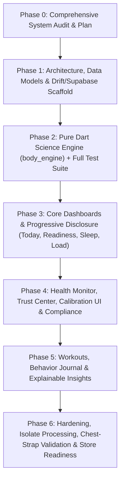

# Comprehensive System & Physiological Audit: Recova

**Document Version:** 1.0.0  
**Audit Date:** November 7, 2026  
**Status:** Complete — Pending User Review & Approval  
**Target Milestone:** Transformation into a Tier-1 Body Intelligence Platform (WHOOP / Garmin Class)

---

## Executive Summary

Recova is currently a functional Flutter prototype designed to ingest biometric telemetry from Android Health Connect and iOS HealthKit, persist records locally via Drift (SQLite), compute derived readiness metrics (Recovery, Strain, VO₂ Max, Sleep Architecture, and Functional Body Age), and display them in a dark OLED glassmorphic dashboard.

While the app demonstrates solid fundamentals (151 passing unit/widget tests, clean Flutter BLoC/Cubit state management, and an attractive visual language), it contains **critical physiological shortcuts, unscientific data syntheses, architectural layer violations, and total absence of cloud synchronization/compliance structures**. 

To compete in the WHOOP / Garmin class while avoiding legal/FDA regulatory pitfalls and building lasting user trust, Recova must transition to a **pure, transparent, versioned scientific engine (`body_engine`)**, enforce **radical honesty** (calibration badges, confidence intervals, zero fake data), separate morning recovery from intra-day energy drain, and implement offline-first Supabase sync with Row-Level Security.

---

## 1. Architecture vs. Clean Architecture

### 1.1 Current Directory Structure

```text
lib/
├── core/
│   ├── constants/       # health_types.dart
│   ├── error/           # failures.dart
│   ├── theme/           # app_theme.dart, design_tokens.dart, recova_colors.dart
│   └── utils/           # date_utils.dart, ppg_hrv_calculator.dart, sleep_data_sanitizer.dart
├── data/
│   ├── database/        # app_database.dart, tables/, daos/
│   ├── datasources/     # health_platform_datasource.dart
│   └── repositories/    # health_repository_impl.dart
├── domain/
│   ├── entities/        # health_record.dart, derived_metric.dart, etc.
│   ├── repositories/    # health_source_repository.dart
│   ├── services/        # vo2_max_estimator.dart
│   └── usecases/        # compute_recovery_score.dart, compute_baselines.dart, compute_vo2max.dart, compute_body_age.dart
├── features/
│   └── body_age/        # Self-contained feature folder (data/, domain/, presentation/)
├── presentation/
│   ├── components/      # UI widgets (glass_card.dart, radial_score_gauge.dart, etc.)
│   ├── cubits/          # dashboard, health_permission, health_sync, body_age
│   └── screens/         # pulse_screen.dart, main_shell_screen.dart, strain_screen.dart, sleep_screen.dart, etc.
├── services/            # background_sync_service.dart, home_widget_service.dart, user_profile_service.dart
└── main.dart
```

### 1.2 Dependency Inversion & Layer Direction Violations

| Offending File | Violation Description | Target Rule Violated |
| :--- | :--- | :--- |
| `lib/core/utils/ppg_hrv_calculator.dart` | Imports `package:whoop/data/database/app_database.dart` (`RawHealthRecord`). | **Core layer must never depend on Data layer.** Core must be leaf-level. |
| `lib/core/utils/sleep_data_sanitizer.dart` | Imports `package:whoop/data/database/app_database.dart` (`RawHealthRecord`). | **Core layer must never depend on Data layer.** |
| `lib/domain/repositories/health_source_repository.dart` | Imports `package:whoop/data/database/app_database.dart` (`DerivedMetric`, `DailyBaseline`). | **Domain contracts must never depend on Data models or generated Drift classes.** |
| `lib/services/user_profile_service.dart` | Bypasses repository/database entirely; directly reads and writes demographic state to `SharedPreferences`. | **All persistence belongs in the Data repository/Drift layer.** |
| `lib/presentation/screens/pulse_screen.dart` | Directly instantiates concrete repositories: `BodyAgeRepositoryImpl()` and `UserProfileService`. | **Presentation must receive abstract repository contracts or usecases via Dependency Injection.** |
| `lib/presentation/screens/main_shell_screen.dart` | Directly instantiates `BodyMeasurementRepositoryImpl()` and `BodyAgeRepositoryImpl()`. | **Presentation must not instantiate Data layer implementations.** |
| Architectural Split: Body Age vs. Core | `lib/domain/usecases/compute_body_age.dart` (1,097 lines) coexists with `lib/features/body_age/` (separate clean-architecture slice). | Redundant code paths and dual maintenance burden. |

---

## 2. Wearables, APIs, and Ingestion Audit

### 2.1 Integrated Wearables & APIs
- **Platform Health Store**: Google Health Connect (Android) and Apple HealthKit (iOS) via `package:health: ^13.3.2`.
- **Target Wearable**: Tested against Nothing X / CMF Watch (via Health Connect sync), plus general Android/iOS health sources.
- **Direct Vendor REST APIs**: **None.** No Garmin Health API, Oura Cloud API, Polar Open AccessLink, WHOOP Developer API, or Fitbit Web API are implemented.
- **Chest-Strap ECG / Polar H10**: No BLE or direct RR stream capture.

### 2.2 Telemetry Signals & Ingestion Granularity

| Biometric Signal | HealthDataType | Granularity / Frequency | Notes & Limitations |
| :--- | :--- | :--- | :--- |
| **Heart Rate** | `HEART_RATE` | Point samples (1 to 5 min intervals from optical PPG) | Variable sampling by vendor app; prone to motion artifacts. |
| **Resting Heart Rate** | `RESTING_HEART_RATE` | Daily discrete value (1–2 readings/day) | When missing, fallback extracts 10th percentile of raw HR. |
| **HRV** | `HEART_RATE_VARIABILITY_RMSSD` (Android) / `SDNN` (iOS) | 1 overnight aggregate (or sparse snapshots) | Health Connect only supports RMSSD; HealthKit uses SDNN. True raw RR intervals are **not** ingested. |
| **Sleep Sessions & Stages** | `SLEEP_SESSION`, `SLEEP_DEEP`, `SLEEP_LIGHT`, `SLEEP_REM`, `SLEEP_AWAKE` | Interval stages (start/end timestamp pairs) | Multi-source collisions common (e.g. Google Fit + Watch app); handled via `SleepDataSanitizer`. |
| **SpO₂ (Blood Oxygen)** | `BLOOD_OXYGEN` | 1–5 samples overnight | Low frequency; vendor-dependent nocturnal tracking. |
| **Respiratory Rate** | `RESPIRATORY_RATE` | 1 overnight average reading | Often absent on budget wearables. |
| **Activity & Steps** | `STEPS`, `WORKOUT`, `ACTIVE_ENERGY_BURNED` | Cumulative / Interval | Steps deduplicated via platform aggregate API (`getTotalStepsInInterval`). |
| **Biometrics** | `WEIGHT`, `HEIGHT`, `BODY_FAT_PERCENTAGE`, `BODY_TEMPERATURE` | Point entries | Usually manual or smart-scale inputs. Skin temperature deviation is not extracted. |

### 2.3 Sync Cadence & Triggers
1. **Background Sync**: Scheduled via `workmanager` every 30 minutes (`com.recova.healthSync`). Execution runs in a dedicated background isolate.
2. **Foreground Auto-Sync**: Fires on `MainShellScreen` mount, app resume (if >30 min elapsed), and periodic 30-minute foreground timer.
3. **Manual Sync**: Tapping the sync icon on `PulseScreen`.
4. **Lookback Logic**: Initial sync pulls past 30 days (`HealthTypes.initialLookback`). Subsequent delta syncs query from `SyncMetadata.lastSyncedAt` (with a forced 48-hour lookback for sleep records to prevent clipping cross-midnight sessions).

---

## 3. Scientific Engine & Algorithm Logic Audit

### 3.1 Unscientific Shortcuts & Trust Breaches

```
⚠️ CRITICAL TRUST DEFECT 1: Synthetic RMSSD Calculation
In `lib/core/utils/ppg_hrv_calculator.dart`:
When genuine HRV records are absent, the app calculates differences between consecutive 1-minute HR averages,
converts them via (60,000 / BPM), calculates RMSSD and SDNN, and blends them (0.4*RMSSD + 0.6*SDNN).
PHYSIOLOGICAL REALITY:
Minute-to-minute heart rate changes represent gross autonomic tone, movement, or breathing drifts,
NOT millisecond-level beat-to-beat variability. Calculating RMSSD on BPM samples produces a fabricated,
unscientific number. If true RR intervals or vendor HRV are unavailable, the engine MUST emit null with a
"Hardware does not support HRV" state rather than fabricating variability.
```

```
⚠️ CRITICAL TRUST DEFECT 2: Fabricated Sleep Stages
In `lib/core/utils/sleep_data_sanitizer.dart` (lines 98-100 & 195-198):
When a wearable reports sleep duration without stage breakdown (common in budget devices):
  deep = (totalM * 0.222).round();
  rem = (totalM * 0.236).round();
  core = totalM - deep - rem;
  awake = min(18, (totalM * 0.05).round());
PHYSIOLOGICAL REALITY:
Fabricating Deep (22.2%) and REM (23.6%) stages presents synthetic data as genuine biological telemetry.
The app violates Non-Negotiable Principle 2 ("Honesty over polish"). When stages are missing, the UI must
honestly report total sleep duration and flag "Stage data unavailable from sensor."
```

```
⚠️ CRITICAL TRUST DEFECT 3: Daytime Strain Distorting Recovery Score
In `lib/domain/usecases/compute_recovery_score.dart`:
The Recovery score (0–100) dynamically decreases during the day when workout strain accumulates
(up to -22 points), and increases with restful hours (+1.25 pts/hr).
PHYSIOLOGICAL REALITY:
In sports science (and in WHOOP/Garmin), Recovery / Readiness is an immutable morning baseline
reflecting overnight restoration and ANS balance. Daytime fatigue and energy depletion belong to an
Energy Reserve / Body Battery model or Strain balance — NOT a fluctuating morning Recovery score.
Conflating recovery with intra-day fatigue confuses athletes regarding their morning physiological readiness.
```

### 3.2 Magic Numbers and Hardcoded Assumptions

| Location | Hardcoded Value | Physiological Rationale / Defect |
| :--- | :--- | :--- |
| `ComputeRecoveryScore` | Weights: `HRV 40%`, `RHR 30%`, `Sleep 20%`, `Resp 5%`, `SpO2 5%` | Unvalidated weights; hardcoded in usecase instead of a versioned `engine_config.dart`. |
| `ComputeRecoveryScore` | Default fallbacks: `HRV=55ms`, `RHR=60bpm`, `Sleep=480m`, `Resp=14rpm`, `SpO2=97%` | Fabricates "normal" scores for new users instead of showing an honest "Collecting baseline" state. |
| `ComputeRecoveryScore` | `finalScore = 50.0` when 0 components exist | Fabricates a moderate score when zero biometric data exists. |
| `ComputeVo2Max` | `maxHr = maxHrFromExercise > 190 ? maxHr : 190.0` | Arbitrary 190 bpm ceiling/floor; heavily distorts VO₂ Max for older athletes or those with lower Max HR. |
| `ComputeVo2Max` | `VO2max = 15.3 * (HRmax / HRrest)` | Uth–Sørensen ratio has large standard errors (±5–8 ml/kg/min) compared to GPS pace/HR extrapolation. |
| `HealthRepositoryImpl` | TRIMP scale constant: `0.02 * accumulatedTrimp` | Arbitrary dampening constant mapped to 0–21; lacks validation against standard Banister/Edwards models. |
| `ComputeBaselines` | Baseline duration: 7 days and 30 days median | Missing 60-day normal range (`mean ± 0.75 SD`) and natural-log transformation `ln(RMSSD)`. |

---

## 4. Database, Schemas, and Synchronization

### 4.1 Current Drift (Local SQLite) Tables
1. `RawHealthRecords`: Stores raw samples (`recordType`, `value`, `valueSecondary`, `unit`, `startTime`, `endTime`, `sourceId`, `syncedAt`). Unique index: `(recordType, sourceId, startTime)`.
2. `DerivedMetrics`: Daily summary (`date`, `estimatedVo2Max`, `recoveryScore`, `recoveryComponentRhr`, `recoveryComponentSleep`, `recoveryComponentSpo2`, `primaryFactor`). Unique on `date`.
3. `DailyBaselines`: Rolling 7d/30d baselines (`date`, `restingHrBaseline7d`, `restingHrBaseline30d`, `sleepDurationBaseline7d`, `spo2Baseline7d`). Unique on `date`.
4. `BodyMeasurements`: User weight & body fat logs (`userId`, `measuredAt`, `weightKg`, `bodyFatPct`, `source`, `synced`).
5. `BodyAgeSnapshots`: Monthly computed body age snapshots (`userId`, `calculatedAt`, `bodyAge`, `chronologicalAge`, `factorAgesJson`, `synced`).
6. `SyncMetadata`: Last sync timestamp per record type.
7. `SyncLogs`: Sync execution logs for debugging.

### 4.2 Missing Drift Entities Required by Master Spec

- ❌ `user_profile` table (presently trapped in `SharedPreferences`).
- ❌ `raw_hr_sample`, `raw_rr_interval`, `raw_spo2_sample`, `raw_temp_sample`, `raw_respiration_sample`, `raw_motion_sample` with explicit quality flags.
- ❌ `sleep_session` table with distinct stage durations, efficiency, nocturnal disturbances, and skin temp deviation.
- ❌ `workout_session` table storing sport type, start/end, time-in-zones, TRIMP, and recovery cost.
- ❌ `baseline_snapshot` table (storing daily 60-day mean & SD of `ln RMSSD`, RHR, etc. for reproducible history).
- ❌ `journal_entry` table (behavior tags: alcohol, caffeine, late meal, travel, stress).
- ❌ `insight` table (explainable rule-based insights linked to source metric IDs).
- ❌ `device_connection` table.
- ❌ Timezone metadata: All existing tables store raw local `DateTime` without timezone offsets (`stored_tz_offset`), causing historical distortion when users travel across timezones.
- ❌ Algorithm provenance: `DerivedMetrics` does not store `algorithm_version`, `confidence`, or `data_quality`.

### 4.3 Supabase & Cloud Synchronization Status
- **Current Status**: **0% Implemented.**
- `pubspec.yaml` contains no `supabase_flutter` dependency.
- There are no remote schemas, sync daemons, offline queue managers, or Row-Level Security (RLS) policies.
- Data exists solely on the local device SQLite file.

---

## 5. UI, Theming, State Management, and Test Coverage

### 5.1 Presentation Layer Quality
- **Theme & Identity**: The app features a high-end, dark-first design system (`Tok` & `RecovaColors`) built on deep black canvases (`#0A0A0A`, `#050505`), liquid glassmorphic surfaces, and bioluminescent accent colors (Recovery Emerald `#00F090`, Restorative Azure `#00D2FF`, Kinetic Amber `#FF6B00`, Neural Violet `#8B5CF6`).
- **Brand Originality**: Does not copy WHOOP's three side-by-side circular dials or Garmin's tabular cards. Uses a single hero concentric radial gauge, vital metric tiles, and specialized detail views.
- **State Management**: Uses `flutter_bloc` (Cubit). States are largely immutable, but some screens instantiate repositories directly inside `initState` or call `setState` alongside Cubits.
- **Navigation**: Uses an older `PageView` with `BottomPillNavBar` and imperative `Navigator.push`. Screen naming contains confusion (`recovery_deep_dive_screen.dart` is aliased as `BodyDataScreen` and displays VO₂ Max).

### 5.2 Test Coverage Analysis
- **Current Tests**: 151 unit/widget tests passing across 21 files.
- **Coverage Highlights**:
  - Baseline calculations (`compute_baselines_test.dart`)
  - Recovery score weighting (`compute_recovery_score_test.dart`)
  - VO₂ Max 7-day vs 30-day (`vo2max_7d_vs_30d_test.dart`)
  - Drift upsert logic (`drift_upsert_test.dart`)
  - UI overflow across phone form factors (`ui_screens_overflow_test.dart`)
  - Body age calculation & dialogs (`compute_fitness_body_age_test.dart`)
- **Coverage Deficits**:
  - ❌ Zero golden screenshot tests for design system consistency.
  - ❌ Zero property-based unit tests for math edge cases (e.g. DST changes, missing data days, extreme outliers).
  - ❌ No integration test verifying the full pipeline: `HealthDataPoint` → `Ingestion` → `Drift` → `body_engine` → `DashboardCubit` → `UI`.

---

## 6. Gap Analysis Against Target Specification

| Feature / Domain Area | Target Specification | Current State | Trust & Compliance Impact |
| :--- | :--- | :--- | :--- |
| **Scientific Engine** | Pure Dart `body_engine` module, 0 Flutter imports, versioned config (`engine_config.dart`). | Scattered usecases in `lib/domain/usecases/` and `lib/core/utils/` importing Drift. | **HIGH**: Math is untracked, difficult to audit, and mixes UI/DB concerns. |
| **HRV Transformation** | Overnight RMSSD, natural-log transformed (`ln RMSSD`), 60d normal range (`mean ± 0.75 SD`), 7d baseline, 7d CV. | Raw RMSSD/SDNN median over 14 days, synthetic PPG calculation on 1-min HR. | **CRITICAL**: Biometrically invalid; false sense of recovery precision. |
| **Calibration States** | Days 1–3: "Collecting baseline"; Days 4–13: "Calibrating"; Day 14+: Full score. | Instant score on Day 1 using hardcoded clinical defaults (`55ms`, `60bpm`). | **CRITICAL**: Misleads users before true individual baselines are formed. |
| **Confidence Indicator** | High / Medium / Low / Calibrating with explicit data quality flags. | Not computed; score is always displayed with identical visual certainty. | **HIGH**: Destroys trust when sensor fit is loose or data is sparse. |
| **Explainability** | "Why this score?" bottom sheet with exact formula weights, inputs, and baselines. | Basic `RecoveryCalculationScreen` exists, but lacks personal normal bands and input provenance. | **MEDIUM**: Users cannot audit their score calculation against raw data. |
| **Health Monitor Panel** | 5-metric panel (HRV, RHR, Resp, SpO₂, Temp deviation) vs normal range with neutral wellness flags. | Separate disconnected screens (`hrv_detail_screen`, `resting_hr_detail_screen`, etc.). | **HIGH**: Lacks a consolidated "Something is off" early wellness alert. |
| **Daytime Stress & Energy Reserve** | Daytime stress (0–100, 4 bands) + Energy Reserve (charging in sleep, draining in day). | Recovery score itself drops during the day; no separate Energy Reserve or daytime stress engine. | **HIGH**: Confuses recovery with acute intra-day energy. |
| **Workouts & TRIMP** | Sport-specific logging, HR zones (Karvonen HRR), Banister/Edwards TRIMP to 0–21 scale. | Basic TRIMP formula applied to all daily HRs; fallback step estimation; workouts not saved as distinct entities. | **MEDIUM**: Over- or under-estimates workout cardiovascular load. |
| **Journal & Correlation** | Behavior tagging (alcohol, caffeine, travel) + honest 30d correlations with sample sizes. | Not implemented. | **MEDIUM**: Misses high-retention habit-tracking feature. |
| **Compliance & Disclaimers** | Strict FDA wellness disclaimers, banned clinical terms, clear methodology page. | Informal language; no dedicated methodology page or legal disclaimer terms. | **CRITICAL**: Exposes app to regulatory action (e.g. FDA 2026 wellness policy). |
| **Cloud Sync & Privacy** | Supabase offline-first sync with Row-Level Security (`auth.uid() = user_id`), data export & deletion. | 100% local Drift database; no cloud sync; profile stored in SharedPreferences. | **HIGH**: Users lose all data on device change; no cloud compliance. |

---

## 7. Risk Assessment

1. **Regulatory & Legal Risk (High)**: Lack of prominent non-diagnostic disclaimers and methodology transparency violates the FDA's finalized Jan 2026 General Wellness Guidance.
2. **Physiological / Credibility Risk (High)**: Generating synthetic RMSSD from 1-minute HR averages and synthesizing sleep stages when missing will immediately be discovered by quantified-self athletes and coaches, permanently damaging credibility.
3. **Data Loss & Corruption Risk (Medium)**: Storing user demographics in `SharedPreferences` separate from SQLite; lack of cloud backup means phone loss or app cache clearing erases historical data.
4. **Timezone & Historical Skew Risk (Medium)**: Lack of timezone offsets in SQLite timestamps will corrupt rolling 7-day and 60-day baselines when an athlete travels across timezones.
5. **UI Thread Performance Risk (Low-Medium)**: Heavy multi-day baseline aggregation and VO₂ Max queries run in SQLite on the main isolate. On mid-range Android devices with 30,000+ HR records, this causes frame drops during sync.

---

## 8. Proposed Phased Migration Plan



### Phase 1 — Foundations & Data Layer Architecture
- Refactor folder hierarchy to strict Clean Architecture. Eliminate cross-layer imports in `core/` and `domain/`.
- Introduce Dependency Injection via `get_it`.
- Expand Drift schema to support target entities: `user_profile`, `sleep_session`, `workout_session`, `daily_metrics`, `baseline_snapshot`, `journal_entry`, `insight`, `device_connection`, and `sync_log`.
- Add UTC timestamps with stored timezone offsets (`stored_tz_offset`).
- Add `algorithm_version`, `confidence`, and `data_quality` columns to all derived tables.
- Scaffold Supabase client configuration and RLS migration scripts in `supabase/migrations/`.
- Keep existing app completely runnable with backward-compatible adapters.

### Phase 2 — Pure Science Engine (`body_engine`)
- Create standalone `lib/domain/body_engine/` (zero Flutter/UI dependencies).
- Centralize all physiological constants and weights in `engine_config.dart` with an incrementable `algorithmVersion = '2.0.0'`.
- Implement physiologically sound algorithms:
  - **HRV**: Overnight RMSSD, natural-log `ln(RMSSD)`, 60-day normal range (`mean ± 0.75 SD`), 7-day rolling baseline, 7-day CV. Purge synthetic PPG-from-BPM calculation.
  - **RHR**: Overnight sustained nadir/median, inverted baseline deviation.
  - **Sleep**: True Sleep Need calculation (baseline + strain addition + debt payoff), restorative stage ratios (Deep + REM), eliminate fabricated sleep stages.
  - **Readiness Score**: Sigmoid composite of log-normalized HRV z-score, RHR z-score, Sleep sufficiency z-score, and Respiratory z-score.
  - **Calibration Engine**: Days 1–3 collecting (no score emitted), Days 4–13 calibrating (provisional score + badge), Day 14+ full score.
  - **Load Score (0–21)**: Heart Rate Reserve (Karvonen) zone-weighted TRIMP.
  - **Daytime Stress & Energy Reserve**: Rest-only HRV stress (0–100) and charging/draining Energy Reserve.
- Develop 100% pure unit test coverage with property-based testing and golden test fixtures in `test/fixtures/`.

### Phase 3 — Core Screens & Explainability UI
- Rebuild Home ("Today") dashboard around a clear, dominant Readiness answer, daily load target, tonight's sleep target, and top 2–3 drivers.
- Implement tiered disclosure:
  - Tier 1: Hero score gauge + driver chips.
  - Tier 2: 7-day and 30-day trend charts with individual 60-day normal range bands.
  - Tier 3: "Why this score?" bottom sheet detailing exact inputs, personal baseline, deviation, and component weights.
- Implement clear "Collecting Baseline" and "Calibrating" visual states with progress trackers.

### Phase 4 — Health Monitor, Trust Center & Compliance
- Build unified **Health Monitor** panel: HRV, RHR, Respiratory Rate, SpO₂, and Skin Temperature deviation against individual 60-day normal bands.
- Neutral status flagging (In Range / Slightly Off / Out of Range) with non-diagnostic guidance ("Consider consulting a clinician if this persists").
- In-app **Methodology & Science Page** explaining every formula, sensor limitations, and algorithm version.
- Legal & privacy controls: explicit data-type permissions, working Data Export (JSON/CSV), and Data Deletion.

### Phase 5 — Workouts, Behavioral Journal & Insights
- Workout logging with HR zone distributions, TRIMP calculation, and recovery cost estimation.
- Daily Behavior Journal with quick-tap tags (caffeine, alcohol, late meal, travel, illness, stress).
- 30-day habit impact correlation engine (average next-day readiness with vs. without tag; minimum 10 occurrences required).
- Explainable rule-based insights engine citing source metrics.

### Phase 6 — Hardening, Validation & Store Readiness
- Move raw sample ingestion and engine calculations to background Dart isolates.
- Implement Polar H10 / chest strap BLE debug comparator tool to benchmark optical PPG against gold-standard ECG RR intervals.
- Accessibility audit (WCAG AA contrast, dynamic type scaling, semantic screen reader labels).
- Performance profiling on mid-range Android hardware.

---

## 9. Blocking Decisions Required from User (Max 3)

Before proceeding to **Phase 1 (Foundations & Data Layer Architecture)**, please provide guidance on these 3 architectural decisions:

1. **Supabase Cloud Scope**:
   Do you want Supabase backend synchronization wired up immediately in Phase 1 (requiring Supabase project URL & anon keys in `.env`, user auth, and remote tables), or should Phase 1 build the Drift schema and local repositories with a clean, swappable Supabase sync interface so you can connect your Supabase project when ready?
2. **Handling Legacy / Non-Stage Wearable Data**:
   When a user's wearable only provides total sleep hours without stage breakdowns (or provides heart rate without raw RR/HRV), do you approve strictly adhering to **Honesty over Polish** by displaying "Stages Unavailable" / "HRV Unsupported by Hardware" and re-weighting the remaining authentic signals, permanently retiring synthetic stage fabrication?
3. **Home Screen Nomenclature & Branding**:
   The current app uses the tab names `Pulse`, `Body Data`, `Strain`, and `Sleep`. For the upgraded original identity, do you prefer retaining these labels, or adopting our proposed standardized terms: **`Today`** (Readiness & Home), **`Sleep`** (Restoration & Sleep Architecture), **`Load`** (Cardiovascular Strain & Workouts), and **`Health`** (Health Monitor & Biometric Vitals)?

